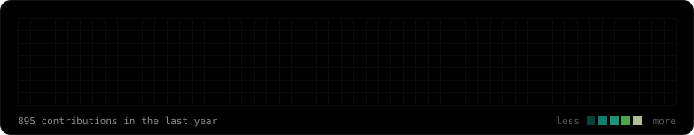

Hey, I'm David, a student from Germany. 
I mostly build AI stuff like MCPs, APIs, automations and productivity tools, but also real-world things like PLC control systems. 
Currently trying to get deeper into infra and inference. 
Most of it is private, DM for private stuff.

